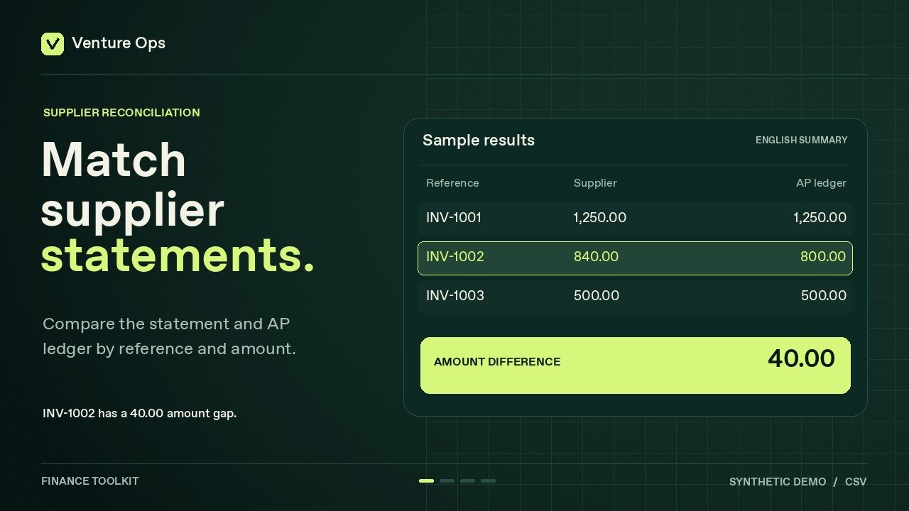
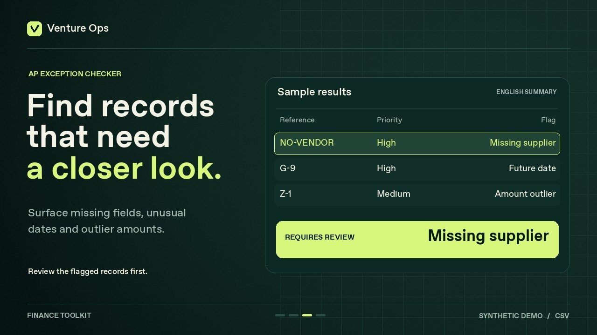

# Venture Ops Finance Toolkit

Four browser-based CSV tools for accounts payable teams. See where supplier statements and ledgers disagree, flag possible duplicate invoices, review missing fields and unusual values, and standardize CSV exports.

[Try the free demo](https://venture-ops-finance-toolkit-qz7otz.v2.appdeploy.ai/) · [Watch the 40-second walkthrough on YouTube](https://youtu.be/A6QtMoRlpBE)

## See the four tools in action

The images below show worked examples from the walkthrough using synthetic data.

### Supplier Statement Reconciliation

Compare supplier statements and AP ledgers by invoice reference and amount.

### Duplicate Invoice Finder

Flag repeated references and possible duplicates for review.

### AP Exception Checker

Surface records with missing fields, unusual dates, or outlier amounts.

### Accounting CSV Cleaner

Standardize headers and values before comparing or analyzing CSV files.

## Offline Edition — sales temporarily paused

The existing Payhip listing has been hidden while a corrective update completes browser and delivery checks. The product title is unchanged. The planned price for the corrected release is USD $29, one-time; the listing remains hidden until release checks pass. Do not treat the earlier preview as proof that the replacement download is released.

The update addresses CSV formula-like text, malformed input, ambiguous columns, invalid dates and stale exports. The private candidate passed 356 automated assertions; real-browser/download acceptance is still pending. Existing license scope remains internal use by one organization.

The eventual ZIP contains four offline browser tools, synthetic examples, instructions and the existing license. Source development files remain private and are not part of this offline offer. Questions: [saudiready.ai@gmail.com](mailto:saudiready.ai@gmail.com).

This public showcase contains preview materials only. Review flagged rows against the original records before acting.
