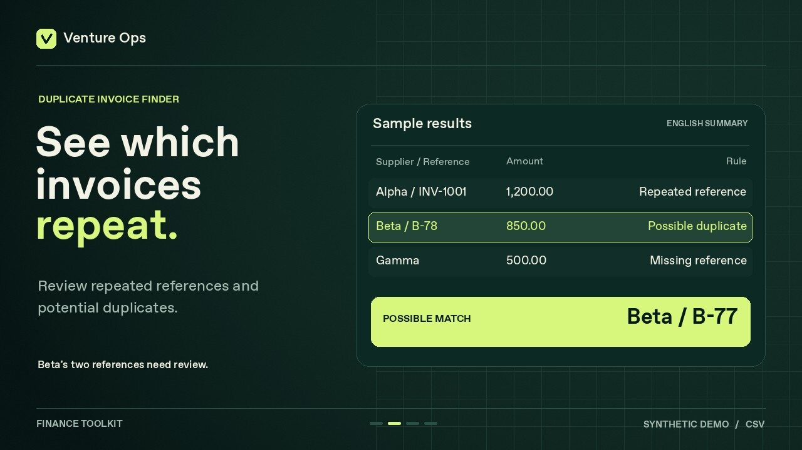
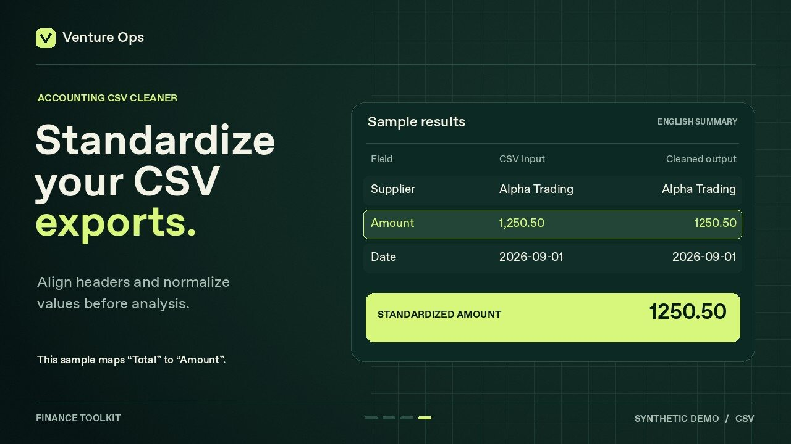

# Venture Ops Finance Toolkit

Four browser-based CSV tools for accounts payable teams. See where supplier statements and ledgers disagree, flag possible duplicate invoices, review missing fields and unusual values, and standardize CSV exports.

[**Buy the Offline Edition on Payhip — USD $29**](https://payhip.com/b/XnqJK) · [Try the free demo](https://venture-ops-finance-toolkit-qz7otz.v2.appdeploy.ai/) · [Watch the 40-second walkthrough on YouTube](https://youtu.be/A6QtMoRlpBE)

## See the four tools in action

The images below show worked examples from the walkthrough using synthetic data.

### Supplier Statement Reconciliation

Compare supplier statements and AP ledgers by invoice reference and amount.

### Duplicate Invoice Finder

Flag repeated references and possible duplicates for review.

### AP Exception Checker

Surface records with missing fields, unusual dates, or outlier amounts.

### Accounting CSV Cleaner

Standardize headers and values before comparing or analyzing CSV files.

## Offline Edition — USD $29

[Buy the Offline Edition on Payhip](https://payhip.com/b/XnqJK)

One-time purchase for internal use by one individual or organization. The listing includes the v1.1 ZIP with four standalone HTML tools, synthetic examples, sample CSVs, English setup instructions, release notes and license. Extract the ZIP and open `offline/index.html` in a desktop browser. No server, sign-in or third-party subscription is required. Editable TypeScript development source is not included.

The linked demo is an earlier preview, not the downloadable v1.1 build.

### Input limits and review requirements

Use UTF-8 comma-separated CSV with unique, unambiguous headers, valid YYYY-MM-DD dates and amounts with at most two fractional digits. Limits: 1,000 data rows, 2 million characters and absolute amounts up to 1 trillion. Reconcile one supplier and currency at a time; automatic currency conversion and supplier separation are not included.

Review every finding against source records. Amount-only suggestions may overlap and must not be summed as unique financial exposure. No automatic posting, payments, ERP connector, tax advice or guaranteed savings is included.

The supplied tools process CSVs locally without application network calls or a backend. Formula-like text is escaped in exports. Device, browser-extension, backup and spreadsheet protections remain your responsibility.

### License and assistance

Internal use only. No resale, public redistribution, sublicensing or third-party hosted service. For installation questions or reproducible issues, contact [saudiready.ai@gmail.com](mailto:saudiready.ai@gmail.com) with an order reference and a synthetic example. Never send credentials or confidential records. No response-time commitment is included; applicable mandatory buyer rights remain unaffected.

This public showcase contains preview materials only. Paid download files remain outside this public repository.
